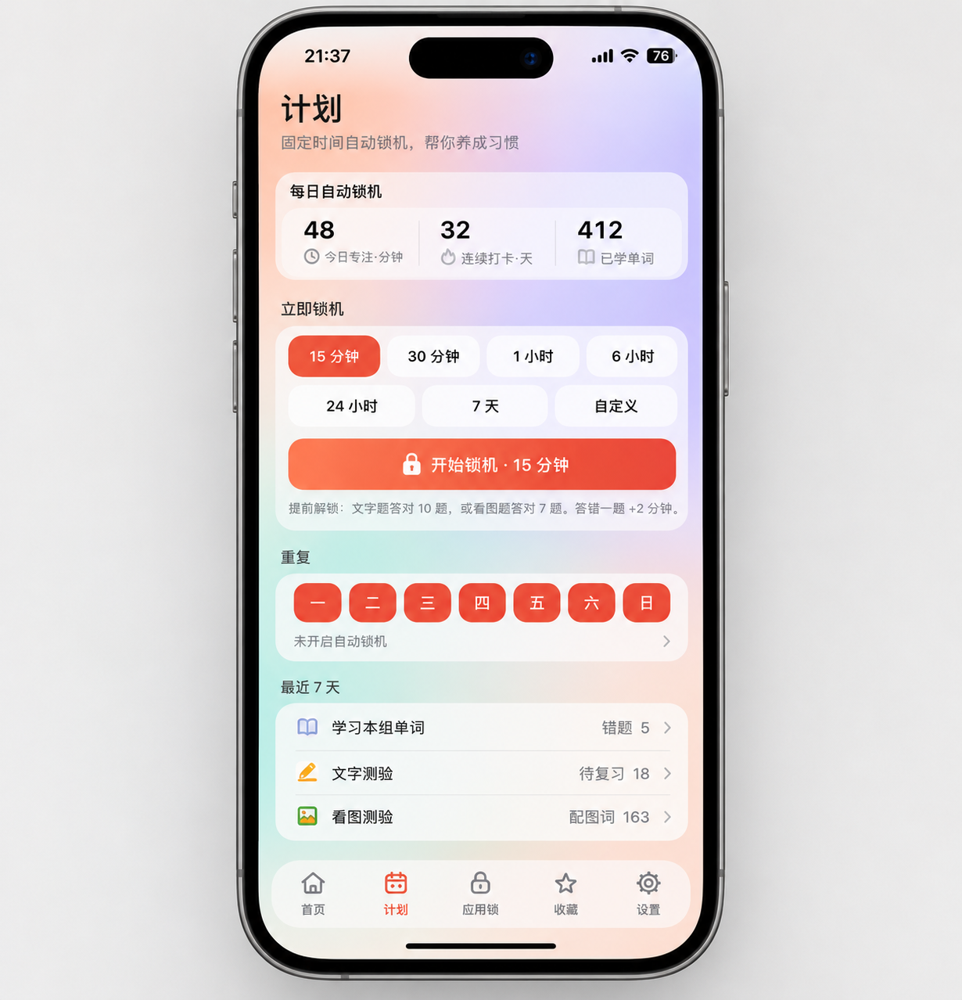
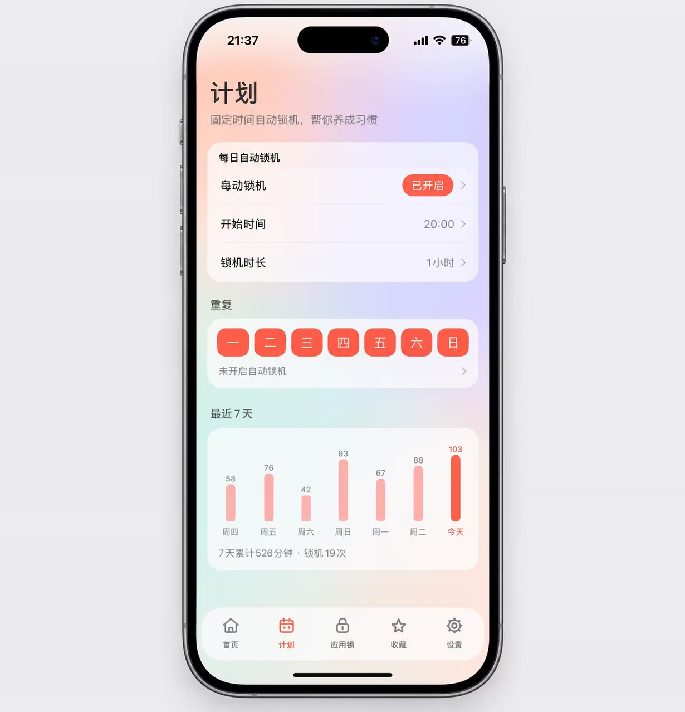

# 单词锁 · WordLock


离线背单词与手机专注工具，原生 Java Android 应用。当前版本 **0.6.5**，Logo 使用 **C · W 锁**。

## 界面参考图

> 以下为界面设计参考图（效果示意），实际界面以安装后的版本为准。

<p align="center">
  
  
</p>

## 功能

- 自主设置锁机时长，白名单放行电话及选定应用。
- 文字题、看图题与背单词解锁。
- 四级、六级、考研、雅思四个词库；例句、收藏及学习记录。
- 应用限时、锁机计划和专注统计。
- 本地 SQLite 存储，无账号、无广告 SDK；应用未声明网络权限。
- 朗读调用系统 TTS 引擎，其联网行为取决于所选引擎。

## 下载

前往 [Releases](https://github.com/manyin6/WordLock/releases/latest) 下载最新 APK。

> **0.6.5 更换了发布签名。** 已安装 0.6.4 及更早版本的用户，需要先卸载旧版再安装，卸载会清除本机学习记录与设置。之后的版本可直接覆盖更新。

## 源码位置

`app/src/com/wordlock/app/`：Java 源码。
`app/res/`：界面资源与 C 方案桌面图标。
`app/assets/`：离线词库、例句、图片及第三方许可。
`app/AndroidManifest.xml`：权限及组件声明。

## 构建

环境：JDK 17、Android SDK Platform 34、Build Tools 34.0.0、zip、Python 3。
本项目使用 aapt2 / javac / d8 命令行构建，不依赖 Gradle。

```bash
export JAVA_HOME=/path/to/jdk17
export ANDROID_SDK_ROOT=/path/to/android-sdk
bash app/build.sh
```

默认输出 `app/build/WordLock-v0.6.5-debug.apk`，使用本机构建目录自动生成的调试密钥。
**仓库不包含原作者发布签名或密码。调试包不能覆盖已安装的原作者正式版。**

正式签名时设置 `WL_KEYSTORE`（密钥路径）、`WL_KEY_ALIAS`、`WL_STORE_PASS` 和 `WL_KEY_PASS` 环境变量，再运行同一脚本。不要将密钥或密码提交到仓库。

## 权限与安全提示

悬浮窗、无障碍服务、使用情况访问、前台服务、电话状态、通知及定时提醒用于相应功能；具体见应用内权限清单。
无障碍服务不读取窗口内容。锁机及应用规则可能限制设备使用，请先用短时长测试；需要停止时可撤回系统权限、清除应用数据或卸载。
本项目不是安全边界，不保证厂商系统下始终有效，也未宣称已通过应用市场审核。

## 安全

发现安全问题请参阅 [SECURITY.md](SECURITY.md)，不要在公开 Issue 中披露细节。

## 开源协议

原创代码、界面及原创 Logo 使用 **MIT License**：允许商业使用、修改、分发和售卖，但必须保留版权声明及 MIT 许可文本。无需强制公开修改源码，也不要求界面显眼署名。
第三方题库、例句和配图遵守各自协议，详见 [THIRD_PARTY_NOTICES.md](THIRD_PARTY_NOTICES.md)。
使用本项目名称或 Logo 不代表获得官方背书。源码含当前版本公开客服联系方式，衍生版本请替换为自己的联系方式。

## 时间与防绕过

锁机和应用规则按开机后经过的时间计算，修改系统时间不会提前结束锁机。手机重启后会重新以系统时间为准，建议开启「自动设置时间」。

## 无障碍反馈排查

引导页第二步提供「检查无障碍状态」，可区分系统授权与服务连接，并复制手机型号、安卓版本及连接状态。
0.6.4 加固了组件匹配、返回后的刷新和服务回调保护；不代表已在全部厂商手机上验证，也不能绕过系统权限或后台限制。
若系统开关仍自动关闭，请提供手机型号、系统版本及系统设置截图；若只是引导页状态异常，请提供复制的诊断信息。

组件匹配回归测试：

```bash
mkdir -p /tmp/wordlock-tests
javac -d /tmp/wordlock-tests app/src/com/wordlock/app/AccessibilityComponents.java tests/AccessibilityComponentsTest.java
java -cp /tmp/wordlock-tests com.wordlock.app.AccessibilityComponentsTest
javac -d /tmp/wordlock-tests app/src/com/wordlock/app/ExemptNames.java tests/ExemptNamesTest.java
java -cp /tmp/wordlock-tests com.wordlock.app.ExemptNamesTest
```
